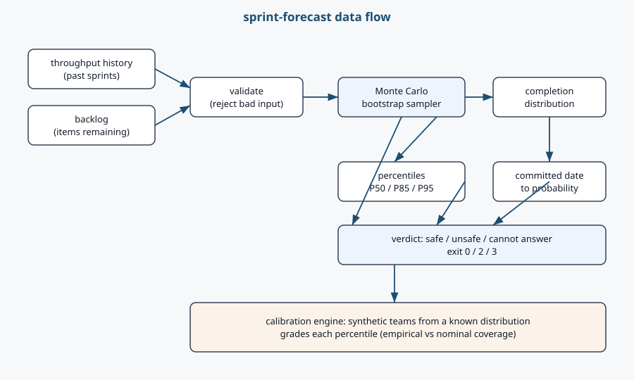
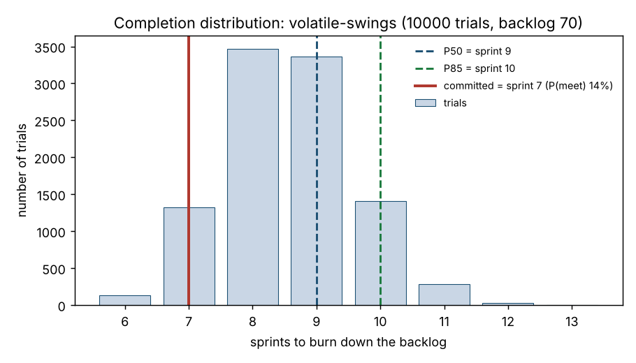
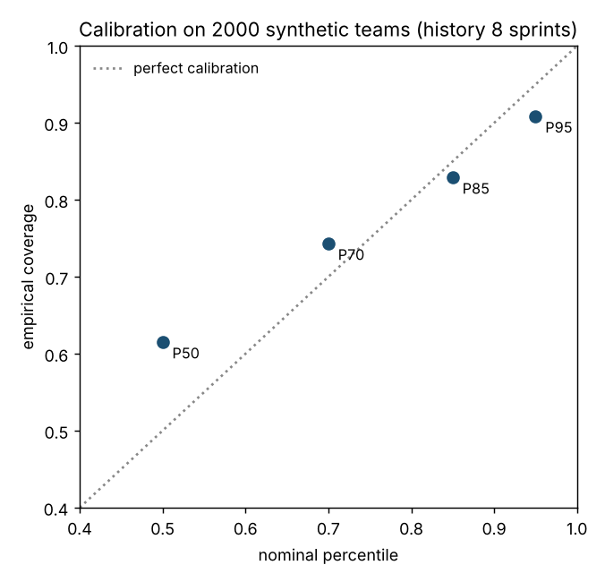
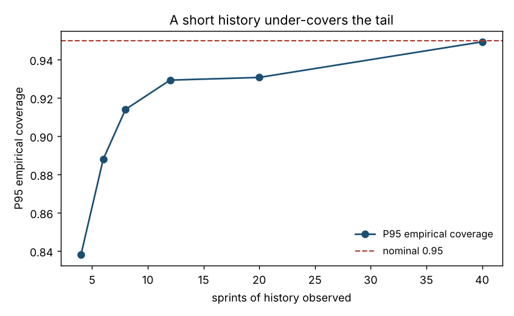

# sprint-forecast

**Prices a committed delivery date as a probability instead of a promise, by resampling a team's own past throughput, and then measures whether its own percentiles can be trusted.**

[](https://github.com/Venkata-Pramid-Reddy-Mitta/sprint-forecast/actions/workflows/ci.yml)


## The thing a committed date cannot tell you

A single committed delivery date is a point, and a point carries no probability. So "will we make it" gets answered with confidence or with a shrug, never with a number. This tool replaces the point with a distribution built from the team's own recorded throughput, and reads three things off it that the date alone cannot state:

1. How likely the committed date actually is, given how this team has really delivered.
2. How wide the gap is between the date the team hits half the time (P50) and the date it hits most of the time (P85), which is the schedule risk a single date hides.
3. Whether its own P85 is really a P85, measured against synthetic teams whose true distribution is known.

## The uncomfortable numbers

On a mixed fixture of 12 scenarios (optimistic, stretch and sandbagged commitments, not stacked one way), priced against each team's own throughput:

- **4 of 12 committed dates were below P50**, a coin flip or worse, sold as a plan.
- **8 of 12 failed the 85% confidence target.** The gap the teams did not budget runs **up to 4 sprints** between P50 and P85 (the median is 1 sprint, so the risk is concentrated in the volatile teams, not spread evenly).
- Graded against ground truth on 2000 synthetic teams, the forecaster's own **P95 covered 90.8%** of outcomes, not 95: a **4.1-point** optimism in the tail. **P85 covered 82.9% of** outcomes. The tail is optimistic because a bootstrap cannot resample a value the team has never recorded.

Every figure above and below is re-measured by `tools/collect_metrics.py` and checked against this document by `tools/check_numbers.py` in CI, across 94 tests at 99.5% line coverage. Break one figure and the build fails (there is a test that proves exactly that).

## Quickstart

Prerequisites: Python 3.11, 3.12 or 3.13. No network, no API keys, no cloud credentials.

```bash
# from a fresh clone, in the repo root
python -m pip install -e ".[dev,charts]"

# the headline: price a committed date against a team's throughput
sprint-forecast forecast --history "7 12 3 9 5 11 4 8 6 10" --backlog 70 --committed 7
# -> verdict UNSAFE, probability of meeting it 14 percent, exit code 2

# the full fixture summary
sprint-forecast scenarios

# reproduce every number in this README, offline
make verify
```

`make verify` runs lint, the test suite, every experiment, and the number checker. It must pass from a fresh clone with no network. That single command is the promise this README makes.

## How it works



The engine is a stationary bootstrap. Each simulated sprint draws, with replacement, a throughput value the team has actually recorded; a trial counts sprints until the backlog is burned down; ten thousand trials give a distribution of completion sprints. The committed date is read off that distribution as a probability. The SVG is generated by `tools/render_diagram.py` (no browser, no Mermaid, so it renders here, in a preview and in a PDF alike).

## One team, in a picture



The committed date (red) sits in the left tail at a 14 percent chance, while P50 and P85 sit two and three sprints later. The point estimate looked fine; the distribution does not. This is the impossibility the tool exists to remove.

## Does a P85 actually hold 85 percent of the time

This is the question that separates a forecaster worth trusting from one that just prints percentiles. The calibration engine builds synthetic teams from a known overdispersed distribution, forecasts each from a short observed history, draws a fresh true future, and measures how often reality landed at or under each predicted percentile.



| percentile | nominal | empirical (2000 teams) | reading |
|---|---|---|---|
| P50 | 0.50 | 0.615 | conservative (integer rounding on small counts) |
| P70 | 0.70 | 0.743 | close |
| P85 | 0.85 | 0.829 | slightly optimistic |
| P95 | 0.95 | 0.908 | optimistic in the tail |

So the honest posture is: the median date is safe to lean on, and the upper percentiles are a little optimistic on a short history. **P95 covered 90.8%** here, on 2000 teams, with a resolution floor of one in 2000. The cause is structural, not a bug: the bootstrap can only resample values it has already seen, so it cannot represent a tail it has not observed yet. ADR-004 states this as the repository's boundary.

## When is a history too short to commit on



Sweeping the number of observed sprints shows the tail closing: P95 coverage climbs **from 83.8% at four sprints** **to 94.9% at forty sprints**. A commitment made on four or six sprints of history is leaning on a tail the data cannot yet support, and the tool can say so rather than pretending otherwise.

## What it buys against what it costs

| what it costs | what it buys |
|---|---|
| ten thousand resamples per forecast (sub-second, but not free) | a committed date carries a probability instead of a shrug |
| it refuses a near-stalled team instead of dating it | no fabricated date on a team that cannot finish within the cap |
| the upper percentiles are measurably optimistic on short history | the amount is published, so a reader can discount them by a known number |

## The bug the measurement found

The simulation cap is meant to stop a near-stalled team from forcing an unbounded run. It was first computed as `max(naive + 1, min(multiple * naive, ABSOLUTE_CAP))`. For a team whose naive estimate alone exceeded the absolute cap, the outer `max` put the cap back above the guard, so the engine looped `naive + 1` times (3001 on the test input) rather than stopping at 2000. The guard was present but not guarding. The symptom was an unbounded message quoting 3001 sprints when the absolute cap was 2000. The fix clamps the cap with a final `min` against the absolute ceiling, which also gives the honest behaviour: a team that needs more sprints than we simulate is simply reported unbounded. `tests/test_forecast.py::test_a_near_stalled_team_capped_at_the_absolute_cap_is_unbounded` fails against the old expression and passes against the fixed one.

## Degenerate inputs

The tool refuses rather than invents. **3 of 4 degenerate** inputs are refused with the "cannot answer" exit code; only the healthy control is forecast.

| input | outcome | exit code |
|---|---|---|
| all-zero history | refused: invalid input | 3 |
| unreachable backlog within the cap | refused: unbounded | 3 |
| empty history | refused: invalid input | 3 |
| healthy team (control) | forecast produced | 0 or 2 |

## The fixture

`data/scenarios.json`, regenerated by `tools/regen_scenarios.py` from a seeded generator so a reviewer can reproduce it byte for byte. It deliberately mixes archetypes so the headline is honest: a steady low-variance team, a volatile team promising its best week, a team with a two-week holiday gap (a zero sprint), a team with only six sprints of history, and a cautious team that over-reserved. The commitments span optimistic, stretch, buffered and sandbagged, so "4 of 12 committed dates were below P50" is a finding, not a setup.

## What this cannot measure

A section, not a footnote, because it is the strongest claim in the repository.

- **Stationarity.** The forecaster assumes the future is drawn from the same distribution as the past. It cannot see a structural change that has not happened yet: a team doubling in size, a scope change, a reorg. On a team that is genuinely non-stationary, the forecast is wrong in a direction the tool cannot detect from throughput alone. This is the Pivot's trigger (ADR-004).
- **Tail accuracy on short history.** Measured, not assumed: the upper percentiles are optimistic until the history is long, and the amount is published above rather than hidden.
- **Synthetic calibration.** The calibration numbers are measured against a chosen negative-binomial ground truth. They transfer as a statement about the method (a bootstrap under-covers an unseen tail), not as a promise about one specific real team, whose true distribution is unknown by definition.
- **Dates are derived, not headline.** Sprint counts are machine independent; a calendar date depends on sprint length and a start date supplied by the caller (ADR-002).

## Layout, exit codes, reproduction

```
src/sprint_forecast/   forecast engine, calibration, validation, report, CLI
data/scenarios.json    the seeded fixture
experiments/           five experiments, each writing JSON to docs/experiments/
tools/                 metrics collector, number checker, diagram, charts, demo
docs/                  metrics.json, adr/, defense-guide.md, charts/, diagram/, video/
tests/                 94 property-named tests
```

Exit codes (the CLI's contract, consumed by a delivery gate):

| code | meaning |
|---|---|
| 0 | forecast produced and the committed date is safe, or no commitment was judged |
| 2 | forecast produced and the committed date is unsafe (the honest answer is no) |
| 3 | the tool could not answer: invalid input or an unbounded forecast |

Make targets: `make lint`, `make test`, `make experiments`, `make receipts`, `make evidence`, and `make verify`, which runs all of them. `check_numbers.py` matches anchor phrases (short word-plus-number phrases) rather than bare digits, so a stale sentence fails the build but an example row of data does not.

## Tech stack

| technology | role here | why this one |
|---|---|---|
| Python 3.11 to 3.13 | the whole tool | the CI matrix proves it on all three |
| NumPy | the bootstrap resampling and percentiles | vectorised sampling is the one hot path; a seeded `default_rng` makes every number reproducible |
| matplotlib | the committed evidence charts | renders headless with no browser, so the evidence reproduces offline (ADR-005) |
| pytest + pytest-cov | 94 tests, line coverage read from the JSON report | the test count and coverage are measured, not typed |
| ruff | lint at a 100 character line | one fast tool for import order and style |
| cmark-gfm | verify the README renders as GitHub renders it | GitHub's own library, so a passing check means a passing page |

## The five ADRs

- ADR-001: resample observed throughput rather than fit a parametric distribution.
- ADR-002: report sprint counts as the headline and derive dates, for machine independence.
- ADR-003: the exit-code taxonomy that separates "unsafe" from "could not answer".
- ADR-004: the stationarity boundary, what this repository deliberately cannot measure.
- ADR-005: no browser in the build, so evidence is matplotlib charts, not screenshots.

## The Pivot and future work

Out of scope on purpose: **non-stationary forecasting** (modelling a throughput trend or a scope change). The trigger to add it is a real scenario with a documented structural break on which the stationary forecast is provably miscalibrated; until then it would be complexity guarding against a case the fixture cannot yet show. A v2 would need: a changepoint test on the history, a weighted or trend-aware resampler, and a first metric to watch (does calibrated coverage hold across a known break).

## License

MIT, see `LICENSE`. Author: Venkata Pramid Reddy Mitta.
